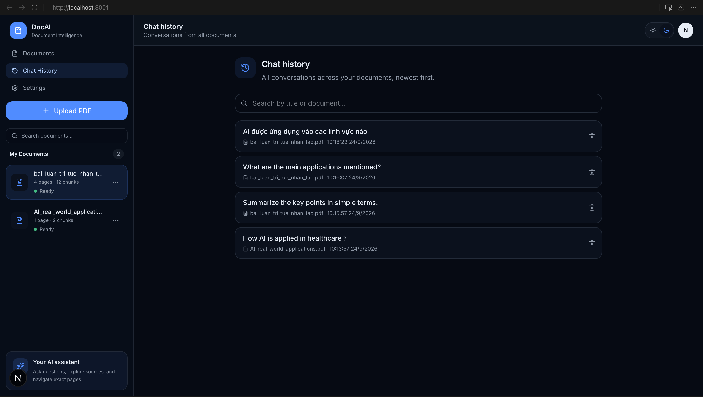
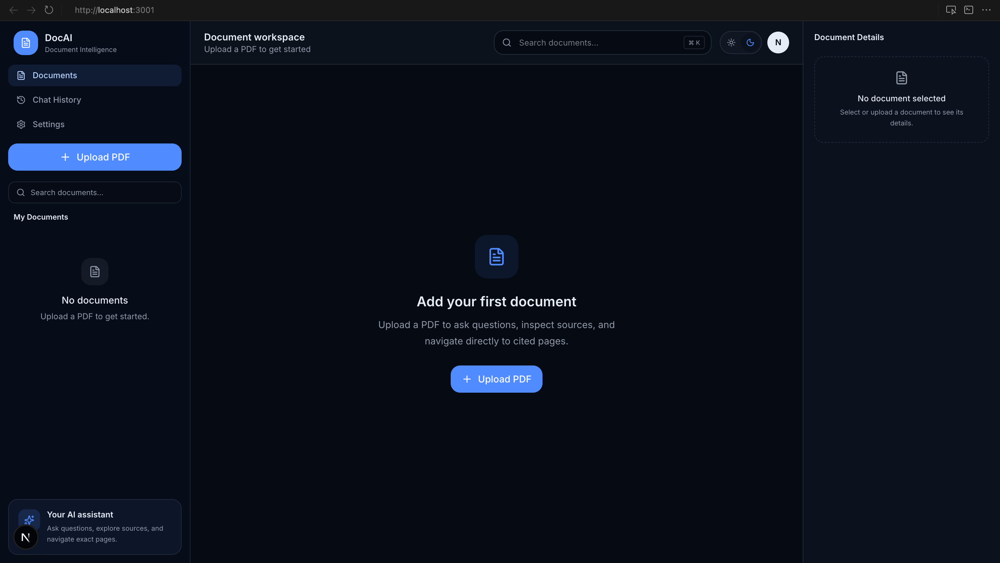
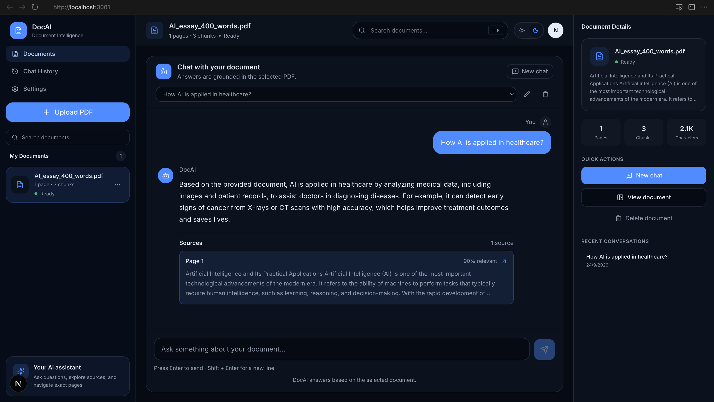
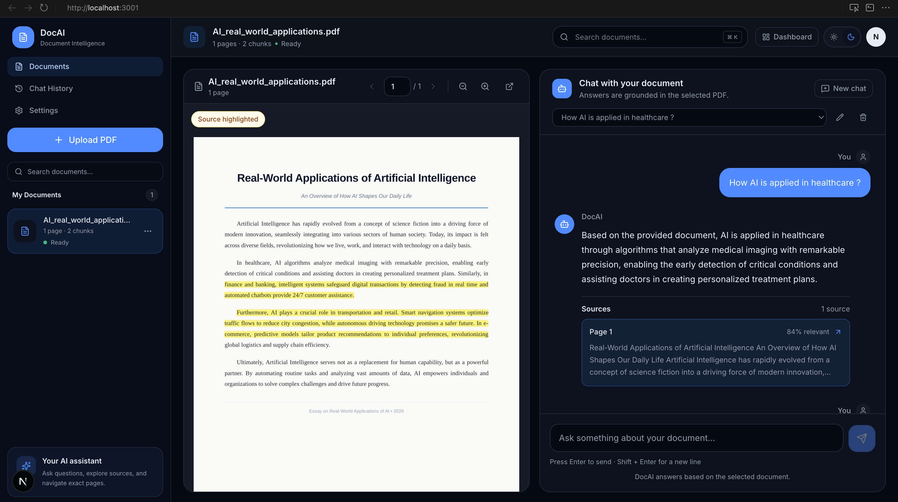
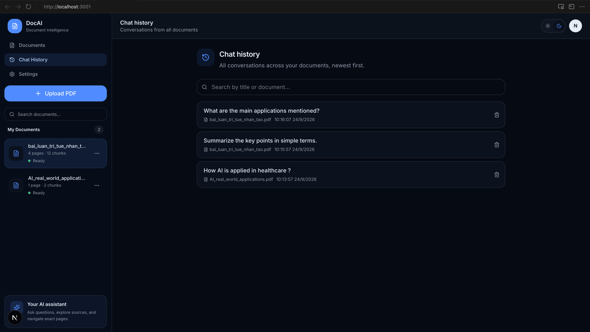

# DocAI

PDF Q&A with **grounded answers**, **page-level citations**, and a built-in viewer. Portfolio RAG app: explicit orchestration (**no LangChain**), async ingestion, PostgreSQL + Qdrant, tests, Docker, and CI.



## Screenshots

| Dashboard | Upload & chat |
| --- | --- |
|  |  |

| Grounded answer with citations | Chat history |
| --- | --- |
|  |  |

## Features

- Upload PDFs (validated, async `processing` / `ready` / `failed`)
- Page-aware chunking (PyMuPDF) → Gemini embeddings → Qdrant
- Chat per document: query rewrite → retrieve top-N → Gemini rerank → top-K answer with sources
- Conversations persisted in PostgreSQL; click a citation to open that PDF page
- Reproducible RAG evaluation under `evaluation/`

## Stack

**Frontend:** Next.js 16, React 19, TypeScript, Tailwind  
**Backend:** Python 3.13, FastAPI, SQLAlchemy, PostgreSQL, Qdrant, Gemini  
**Ops:** Docker Compose, GitHub Actions

## Quick start (Docker)

Requires Docker Compose and a [Gemini API key](https://aistudio.google.com/apikey).

```bash
cp .env.example .env
# Set GEMINI_API_KEY in .env
docker compose up --build
```

| Service | URL |
| --- | --- |
| App | http://localhost:3000 |
| API docs | http://localhost:8000/docs |
| Qdrant | http://localhost:6333/dashboard |

```bash
docker compose down              # keep data
docker compose down --volumes    # wipe DB, vectors, PDFs
```

## Local development

```bash
docker compose up -d postgres qdrant
```

**Backend:** `cd backend` → copy `.env.example` → venv → `pip install -r requirements.txt` → `uvicorn app.main:app --reload`

**Frontend:** `cd frontend` → copy `.env.local.example` → `npm ci` → `npm run dev`

Config: `.env.example`, `backend/.env.example`, `frontend/.env.local.example`.

## RAG flow

```text
PDF → page extract → chunk (no cross-page) → embed → Qdrant
Question → rewrite (history) → vector search → rerank → Gemini answer + citations
```

If reranking fails, retrieval falls back to vector order.

## Evaluation & tests

```bash
# Evaluation (see evaluation/questions.json)
backend/.venv/bin/python evaluation/run_evaluation.py --skip-judge

# Backend tests
PYTHONPATH=backend:. backend/.venv/bin/python -m unittest discover -s backend/tests -v

# Frontend
cd frontend && npm test && npm run lint && npm run build
```

## Layout

```text
backend/app/services/   # RAG, PDF, Qdrant, rerank
frontend/               # workspace UI
evaluation/             # fixtures + run_evaluation.py
```

## Limits (MVP)

BackgroundTasks ingestion (no durable queue), local PDF volume (no object storage), no auth. See code comments and services for tunables (`RAG_*` env vars).
